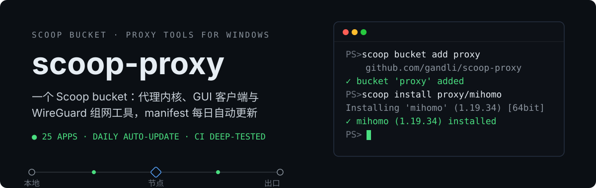
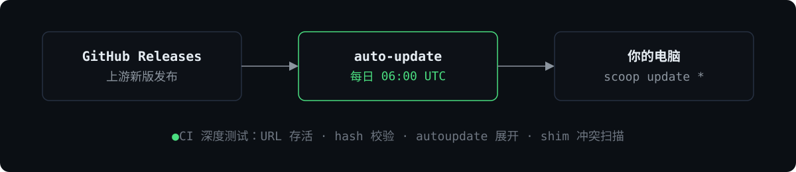

# scoop-proxy

<p align="center">
  
</p>

<p align="center">
  <a href="https://github.com/gandli/scoop-proxy/actions/workflows/ci.yml"></a>
  <a href="https://github.com/gandli/scoop-proxy/actions/workflows/auto-update.yml"></a>
</p>

一个 [Scoop](https://scoop.sh) bucket，收录 25 个代理工具：mihomo / sing-box / Xray / v2ray 内核，各类 GUI 客户端，以及 Tailscale、NetBird 等组网软件。所有 manifest 由每日定时工作流自动跟踪上游版本，无需手动维护。

## 快速开始

```powershell
scoop bucket add proxy https://github.com/gandli/scoop-proxy
scoop install proxy/bowel proxy/mihomo proxy/v2rayn
```

- 支持 64bit 与 arm64 Windows（随上游发布而定）。
- `proxy/tailscale` 与 `proxy/uu-remote` 需要管理员权限安装。
- 查看当前版本：`scoop search` 或 `scoop status`。

## 软件收录

### 代理内核

| App | 说明 |
|---|---|
| [mihomo](https://github.com/MetaCubeX/mihomo) | mihomo (Clash Meta) 内核 |
| [sing-box](https://github.com/SagerNet/sing-box) | sing-box 内核 |
| [xray](https://github.com/XTLS/Xray-core) | Xray 内核 |
| [v2ray](https://github.com/v2fly/v2ray-core) | Project V 的 v2ray 内核 |

### GUI 客户端

| App | 说明 |
|---|---|
| [bowel](https://github.com/21stware/bowel) | mihomo 客户端，覆盖 macOS / Windows / Linux / Android |
| [v2rayN](https://github.com/2dust/v2rayN) | Xray / sing-box / mihomo 多内核 GUI |
| [FlClash](https://github.com/chen08209/FlClash) | Flutter 构建的多平台 mihomo GUI |
| [Clash Verge Rev](https://github.com/clash-verge-rev/clash-verge-rev) | 基于 Tauri 的 Clash Meta GUI |
| [Clash Party](https://clashparty.org/) | Mihomo GUI |
| [Sparkle](https://github.com/xishang0128/sparkle) | Mihomo Party 的 fork |
| [Clash Nyanpasu](https://github.com/libnyanpasu/clash-nyanpasu) | 基于 Tauri 的 Clash GUI |
| [Karing](https://github.com/KaringX/karing) | 兼容 Clash / sing-box / Shadowrocket 订阅的跨平台客户端 |
| [GUI.for.Clash](https://github.com/GUI-for-Cores/GUI.for.Clash) | 轻量 Lua 实现的 mihomo GUI |
| [GUI.for.SingBox](https://github.com/GUI-for-Cores/GUI.for.SingBox) | 轻量 Lua 实现的 sing-box GUI |
| [Throne](https://github.com/throneproj/Throne) | sing-box 驱动的跨平台代理 GUI（Nekoray 后继） |
| [Husi](https://github.com/xchacha20-poly1305/husi) | sing-box GUI 客户端，内置 JBR 运行时（64bit） |
| [SFW](https://sing-box.sagernet.org/clients/desktop/) | sing-box 官方 Windows GUI 客户端 |
| [Clash.Mini](https://github.com/MetaCubeX/Clash.Mini) | 简洁的 mihomo GUI |
| [Pandora-Box](https://github.com/snakem982/Pandora-Box) | 简洁的 mihomo 桌面客户端 |
| [ClashMi](https://github.com/KaringX/clashmi) | 跨平台 Clash Mihomo 客户端（64bit） |

### TUI

| App | 说明 |
|---|---|
| [clashtui](https://github.com/JohanChane/clashtui) | mihomo / sing-box TUI 客户端 |

### 组网与远程

| App | 说明 |
|---|---|
| [Tailscale](https://tailscale.com) | 基于 WireGuard 的 mesh VPN（需管理员权限） |
| [NetBird](https://netbird.io/) | 支持 SSO/MFA 的 WireGuard overlay 网络 |
| [UU Remote 网易UU远程](https://uuyc.163.com/) | 网易远程桌面访问与控制工具（需管理员权限） |
| [RustDesk](https://github.com/rustdesk/rustdesk) | 开源远程桌面软件（Rust 编写），支持自建服务器 |

## 特性

- **每日自动更新** — 定时 workflow 跟踪上游 release，自动改写版本并回填下载 hash。
- **CI 深度测试** — 每个 commit 跑四层校验：官方 Pester 套件、跨 manifest shim 冲突扫描、URL 存活探测、autoupdate 展开验证（版本可解析、URL 无残留占位符、hash 源可用）。
- **hash 校验** — 优先使用上游官方校验文件或 GitHub release digest，无官方源时由 CI 下载回填。
- **双架构** — manifest 覆盖 64bit 与 arm64（随上游发布而定）。

<p align="center">
  
</p>
